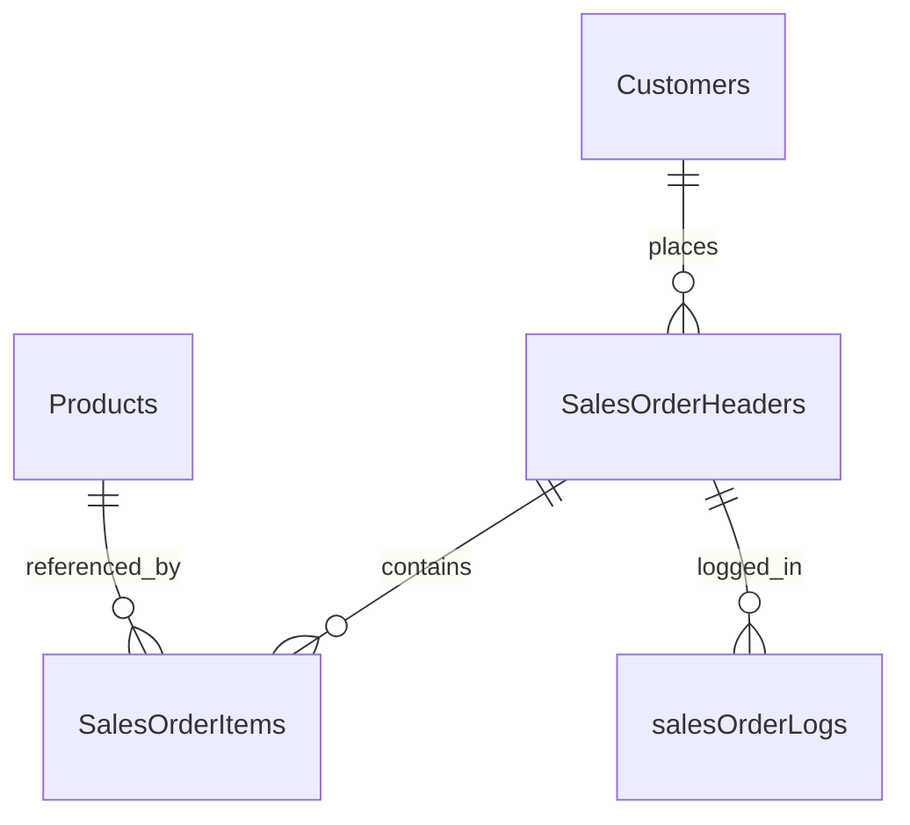

# Sales Order Backend


A backend learning project for **sales order management**, built with **SAP Cloud Application Programming Model (CAP)**, **TypeScript**, and **CDS**. It explores an SAP-style business domain using OData services, entity relationships, and CAP request handlers.

> **Project status:** Work in progress / portfolio project. The domain model and service definitions are present, but parts of the order-processing logic and manual HTTP examples still need correction and verification. This is not a production-ready application.

## What is inside

| Area | Implementation |
| --- | --- |
| Domain model | Customers, products, sales order headers and items, plus order logs in CDS |
| API | `MainService` exposes OData V4 entity projections |
| Business logic | TypeScript event handlers for reads, order creation, pricing, stock and logging (in progress) |
| Persistence | SQLite in-memory configuration for local development |
| Examples | Sample CSV data and `.http` requests for local exploration |

### Data model



## Technology stack

- **SAP CAP / CDS** for the domain model and OData service
- **TypeScript / Node.js** for service handlers and application structure
- **SQLite** for local development
- **HTTP request files** for manual API exploration

## Repository structure

```text
db/
  schema.cds                 # Domain entities and associations
srv/
  main.cds                   # OData service definition
  main.ts                    # Service event handlers
  controllers/               # Customer controller
  services/                  # Customer application service
  factories/                 # Dependency wiring
  models/                    # Customer model
test/
  data/                      # Example CSV datasets
  http/                      # Manual HTTP requests
.cdsrc.json                  # Local-development CAP settings
package.json
tsconfig.json
```

## Run locally

**Prerequisites:** Node.js and npm.

```bash
npm ci
npx cds watch
```

The CAP service is configured at:

```text
http://localhost:4004/odata/v4/main
```

For example, the CDS service defines the following entity sets:

```text
/Customers
/Products
/SalesOrderHeaders
/salesOrderLogs
```

Example HTTP requests are in `test/http/`. They are **manual examples**, not an automated test suite. Some IDs and payloads are placeholders and must be adapted before use.

### Development authentication

The checked-in CAP configuration uses **mocked authentication only in the development profile**, with example `admin` and `read_only_user` roles. It intentionally contains **no passwords**. The service's current `READ` handler checks the `read_only_user` role; review authorization rules before using the application outside local development.

Do not use mocked authentication for production. Keep secrets and environment-specific settings outside version control.

## Next improvements

- Correct order creation validation and association-key handling.
- Review product lookup, quantity checks, price calculation and stock updates.
- Make order persistence and inventory changes transactionally consistent.
- Add automated tests for success and failure scenarios.
- Review access control for orders and stored logs.

## About

Created to practice SAP CAP backend development and concepts that connect naturally with the SAP ecosystem: CDS modeling, OData APIs, backend service implementation and business-process logic.

Learn more about CAP at [cap.cloud.sap](https://cap.cloud.sap/).
