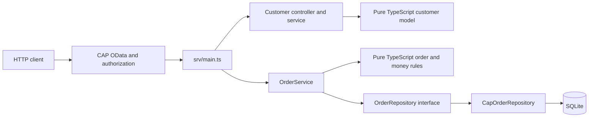

# Architecture and decisions

## Boundaries



`srv/models/` contains validation and pricing with no SAP imports. `OrderService` orchestrates creation and cancellation against an injected repository interface. The CAP adapter supplies queries and joins the current request transaction. The retained customer controller/service boundary applies normalization on writes.

`srv/main.cds` defines the HTTP contract and permissions. `db/schema.cds` defines persistence, uniqueness and server-managed fields. `srv/main.ts` maps request errors and delegates workflow operations. An alternative HTTP/database adapter could reuse the order service and domain models, but must provide equivalent transaction boundaries, authentication and validation. There is no second adapter implemented yet.

## Atomic inventory reservation

A check followed by an unconditional absolute stock write can oversell when requests interleave. The adapter instead executes the equivalent of:

```sql
UPDATE Products
SET stock = stock - :quantity
WHERE id = :id AND stock >= :quantity;
```

The affected-row count must be one. Every product is updated in stable ID order. Order creation, child insertion and audit insertion join the same automatically managed CAP transaction. Throwing from any handler rolls all changes back. There is no separate commit in an after handler.

Pricing first checks that all requested products exist and are available. The conditional write remains the final authority if the stock has changed since that read.

The integration test for duplicate order IDs deliberately fails the insert after reservation and verifies stock and audit rollback. Another sends simultaneous HTTP requests for the final unit and verifies only one succeeds.

The local SQLite adapter has a single connection and serializes write transactions. These tests validate the local configuration. A PostgreSQL or HANA adapter needs its own tests for isolation, row locking, retries and cross-process traffic before any scalability claim.

## Cancellation state

Cancellation conditionally changes `OPEN` to `CANCELLED`. Only the request that performs the transition restores inventory and appends the cancellation event. A subsequent request reads and returns the already cancelled order. If restoration or logging fails, the transition rolls back.

Cancellation preserves the original item prices and totals. The response is reread after the transition so managed timestamps and ETags describe the committed version.

## Money

Catalog amounts are parsed into `bigint` cents. Multiplication, sums and discount rounding occur in integer arithmetic, and values are formatted as decimal strings at the adapter boundary.

All amounts must fit Decimal(15,2), including subtotal before discount. The 10% discount is rounded half up once at order level. Currency is fixed to BRL. Taxes, shipping, FX and per-item discount allocation are outside this version.

## Access and history

The model grants reads to the admin, sales representative and read-only roles. Only admins write customer/catalog data. Admins and sales representatives create and cancel orders. Only admins read audit events. Order/item modifications and audit writes have no generic write grant.

Audit entries contain the authenticated actor ID, event and business snapshot. They do not serialize the framework user object, authentication headers or customer profile. The API keeps these entries immutable; database administrators remain outside that guarantee.

All sales representatives operate within one shared organization. There is no tenant, branch or record ownership filter.

## Runtime and build

The quick-start SQLite WASM driver provides an ephemeral database. The optional persistent mode uses better-sqlite3, with a local `.data/sales.sqlite` file and WAL journaling configured by the CAP adapter. It creates and seeds an empty database only on first use; subsequent starts preserve data and check the SQLite user_version and required tables. Unsupported or incomplete schemas fail startup without reseeding. This is version protection, not a migration framework.

Use a single API process per local database. Stop the API before backing up the whole `.data/` directory, including any SQLite sidecar files. `SALES_DB_FILE` can select a different file, mainly for isolated integration tests. Persistent restart tests verify that created and cancelled orders and their inventory/audit effects survive process termination.

The local server binds to loopback and uses documented development-only credentials. No real SAP system is accessed.

`npm run build` compiles source to JavaScript and copies CDS models, configuration and demonstration fixtures into `dist/`. The compiled path is tested independently. Generated code is ignored by Git.

Production hosting is a separate roadmap item. It requires a selected production database and migrations, managed identity, secret injection, TLS at the hosting edge, backup/recovery, operational monitoring and database-specific concurrency tests. The local file mode is refused under `NODE_ENV=production`; that environment setting alone does not configure production services.

## Compatibility

The customer association remains `customers_id` for the existing API shape. Audit exposure is now `SalesOrderLogs` with an actor and event instead of a full serialized user object. These model changes are not a migration for an older persisted database. The pre-existing `db.sqlite` file is not read or modified; file mode uses a separate, versioned database.

References: [CAP transactions](https://cap.cloud.sap/docs/node.js/cds-tx), [authorization](https://cap.cloud.sap/docs/guides/security/authorization), [TypeScript](https://cap.cloud.sap/docs/node.js/typescript).
